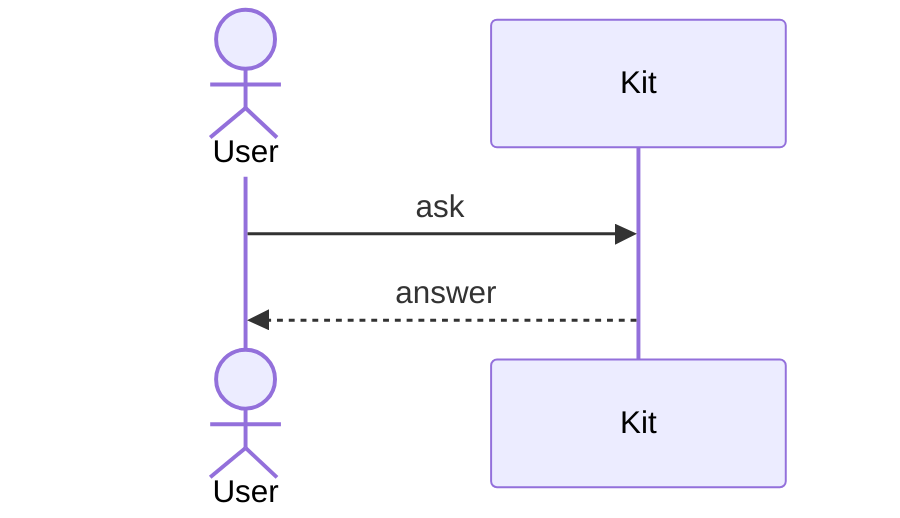

# Mermaid diagrams

Kit draws fenced `mermaid` code blocks as diagrams, in transcripts and anywhere
else Markdown appears. The terminal client draws them with box-drawing
characters; the macOS app draws the same layout natively, with shaped nodes,
curved lines, and text in its interface font. Kit draws them with its own renderer
([ADR 0046](../adrs/0046-draw-mermaid-diagrams-with-kits-own-renderer.md)),
which supports a reviewed subset of Mermaid's syntax, the same in both clients.

````markdown

````

A diagram keeps its shape: it never wraps, and one wider than the pane scrolls
sideways. Its colors follow the active theme. In the macOS app, a diagram's
**Copy** button copies its source.

## When a diagram isn't drawn

A diagram that uses unsupported syntax, is malformed, or is too large shows its
source with the reason it wasn't drawn, such as
``Diagram not drawn: `classDiagram` diagrams aren't drawn yet``. While a
response is streaming, a diagram shows its source until its closing fence
arrives.

## Supported syntax

A diagram may start with YAML frontmatter, of which only `title` is used, and
`%%` comments and `%%{init: …}%%` directives, which are ignored.

### Sequence diagrams

| Syntax | Drawn as |
|---|---|
| `participant A`, `participant A as Label` | A box with a lifeline |
| `actor A`, `actor A as Label` | A box with rounded corners |
| `A->>B: text` | A solid arrow |
| `A-->>B: text` | A dashed arrow |
| `A->B`, `A-->B` | A solid or dashed line without a head |
| `A-xB`, `A--xB` | A line ending in `×` |
| `A-)B`, `A--)B` | A line ending in an open head |
| `A<<->>B`, `A<<-->>B` | A line with heads at both ends |
| `A->>A: text` | A loop back to the same lifeline |
| `Note left of A: text`, `Note right of A: text` | A note beside a lifeline |
| `Note over A: text`, `Note over A,B: text` | A note covering one or two lifelines |
| `loop`, `opt`, `break` … `end` | A labeled frame |
| `alt` … `else` … `end` | A frame divided by dashed lines |
| `par` … `and` … `end` | A frame divided by dashed lines |
| `critical` … `option` … `end` | A frame divided by dashed lines |
| `autonumber`, `autonumber 10 5`, `autonumber off` | Message text numbered from a start by a step, 1 and 1 by default |
| `title Text` | A bold title above the diagram |

Participants appear in the order they are declared or first used. Their names
can't contain `:`, `,`, `;`, `<`, `>`, or arrow pieces such as `->` and `-x`.
Keywords match in any case. Message and note text is one line; `<br>` becomes
a space, and text over 64 columns is cut short with an ellipsis.

`activate`, `deactivate`, the `+` and `-` activation shorthands, and `rect`
highlights are accepted but not drawn. `box`, `create`, `destroy`, links,
participant metadata, and every other statement show the source instead.

### Limits

A diagram is drawn when its source is at most 16 KiB, with at most 24
participants and 200 statements, and the drawing fits within 480 columns and
800 rows.

### Flowcharts

| Syntax | Drawn as |
|---|---|
| `flowchart TD`, `flowchart TB`, `graph TD` | Layers flowing top down |
| `flowchart BT` | Layers flowing bottom up |
| `flowchart LR`, `flowchart RL` | Layers flowing left to right, or right to left |
| `A`, `A[text]`, `A["text"]` | A box |
| `A(text)`, `A((text))` | A box with rounded corners |
| `A([text])` | A rounded box with `(` `)` sides |
| `A[(text)]` | A box with `║` sides, for a database |
| `A{text}` | A box with `<` `>` sides, for a decision; branches sharing a line fork at a `◆` |
| `A --> B`, `A ---> B` | An arrow into the target |
| `A --- B` | A line joining the target |
| `A -.-> B`, `A -.- B` | A dotted arrow or line |
| `A ==> B`, `A === B` | A thick arrow or line |
| `A --x B`, `A --o B` | A line ending in `×` or `○` |
| `A -->|text| B`, `A -- text --> B` | An edge with its text on it |
| `A --> B --> C` | A chain of edges |
| `A & B --> C & D` | An edge from each node on the left to each on the right |
| `A:::name` | The node; the class is ignored |

Statements may be separated by `;`, and a repeated edge is drawn once.
Keywords match exactly, as in Mermaid, so `End` or `Style` can name a node.

Nodes appear in layers by their longest path from a start node, and an edge
that skips layers runs straight past them. Edges from one node with the same
line style branch from a shared line, and edges into one node with the same
line style and end merge into one arrow, as long as every source on the
joined lines leads to every target on them. Otherwise edges get their own
lines and arrows, and a node grows to fit them. An edge that loops back, including one from a node to itself,
runs around the outside of the diagram, to the right of a diagram flowing up
or down and beneath one flowing sideways; shorter loops sit inside longer
ones. In a diagram flowing sideways, nodes in a layer sit one above another
and line up at the layer's start, and node text still reads left to right.
Node and edge text is one line; text over 40 columns is cut short with an
ellipsis.

Edge text sits where only its edge runs: just above the arrow into a node no
other edge enters, else just below a node no other edge leaves, else beside
the layers the edge skips. An edge with text between a node other edges leave
and a node other edges enter skips a layer to make that room. A loop's
text sits beside its climb, or on its run beneath a diagram flowing sideways.
In a diagram flowing sideways, text sits on its edge's line, as in
`─ yes ─►`. A diagram whose edge text has no such room shows its source.

`subgraph` … `end` blocks are drawn as sections, one under another. The
flowchart comes first, with each subgraph drawn as one dashed box marked
`▸` with its title; edges to and from its nodes attach to the box, and an
edge may name a subgraph by its id. Each subgraph is then drawn on its own
under its title, with its nodes and the edges among them, and a dashed box,
such as `Server · API`, for each node outside it that its edges reach. A
subgraph inside another is a box in its parent's section and gets its own
section after. Only a subgraph inside a section is marked `▸`; one outside
is named with where it is, and an edge naming a subgraph reaches an
`all of …` box in that subgraph's own section. A subgraph is written
`subgraph id`, `subgraph id[title]`, or `subgraph "title"`; a `direction`
inside it sets the way its section flows. As in Mermaid, a subgraph takes
the nodes its statements mention when its `end` is reached, unless a
subgraph that ended earlier took them, so a node listed in a subgraph
belongs to it even if edges mentioned it first.

`classDef`, `class`, `style`, `linkStyle`, and `click` statements are accepted
but not drawn. Other node shapes and links show the source instead.

A flowchart is drawn when it has at most 60 nodes, 120 edges, 200
statements, and 20 subgraphs, and its drawing, with all its sections, fits
within 480 columns and 800 rows. Since an edge can appear in several
sections, the sections together are also bounded: each counts as the square
of its nodes and edges, and together they may cost no more than the largest
flowchart without subgraphs.

### Other diagram types

Other diagram types aren't drawn yet and show their source.
