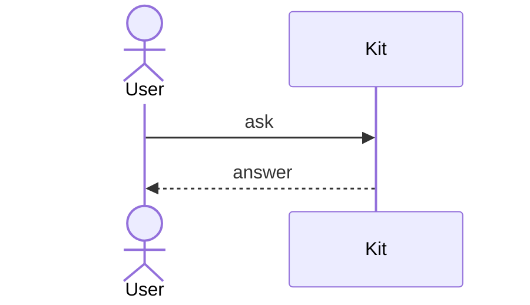

# Mermaid diagrams

The terminal client draws fenced `mermaid` code blocks as diagrams made of
box-drawing characters, in transcripts and anywhere else Markdown appears.
Kit draws them with its own renderer
([ADR 0046](../adrs/0046-draw-mermaid-diagrams-with-kits-own-renderer.md)),
which supports a reviewed subset of Mermaid's syntax.

````markdown

````

A diagram keeps its shape: it never wraps, and one wider than the pane scrolls
sideways. Its colors follow the active theme.

## When a diagram isn't drawn

A diagram that uses unsupported syntax, is malformed, or is too large shows its
source with the reason it wasn't drawn, such as `Diagram not drawn: flowcharts
aren't drawn yet`. While a response is streaming, a diagram shows its source
until its closing fence arrives.

## Supported syntax

A diagram may start with YAML frontmatter, of which only `title` is used, and
`%%` comments and `%%{init: …}%%` directives, which are ignored.

### Sequence diagrams

| Syntax | Drawn as |
|---|---|
| `participant A`, `participant A as Label` | A box with a lifeline |
| `actor A`, `actor A as Label` | A box with rounded corners |
| `A->>B: text` | A solid arrow |
| `A-->>B: text` | A dashed arrow |
| `A->B`, `A-->B` | A solid or dashed line without a head |
| `A-xB`, `A--xB` | A line ending in `×` |
| `A-)B`, `A--)B` | A line ending in an open head |
| `A<<->>B`, `A<<-->>B` | A line with heads at both ends |
| `A->>A: text` | A loop back to the same lifeline |
| `Note left of A: text`, `Note right of A: text` | A note beside a lifeline |
| `Note over A: text`, `Note over A,B: text` | A note covering one or two lifelines |
| `loop`, `opt`, `break` … `end` | A labeled frame |
| `alt` … `else` … `end` | A frame divided by dashed lines |
| `par` … `and` … `end` | A frame divided by dashed lines |
| `critical` … `option` … `end` | A frame divided by dashed lines |
| `autonumber`, `autonumber 10 5`, `autonumber off` | Message text numbered from a start by a step, 1 and 1 by default |
| `title Text` | A bold title above the diagram |

Participants appear in the order they are declared or first used. Their names
can't contain `:`, `,`, `;`, `<`, `>`, or arrow pieces such as `->` and `-x`.
Keywords match in any case. Message and note text is one line; `<br>` becomes
a space, and text over 64 columns is cut short with an ellipsis.

`activate`, `deactivate`, the `+` and `-` activation shorthands, and `rect`
highlights are accepted but not drawn. `box`, `create`, `destroy`, links,
participant metadata, and every other statement show the source instead.

### Limits

A diagram is drawn when its source is at most 16 KiB, with at most 24
participants and 200 statements, and the drawing fits within 480 columns and
800 rows.

### Flowcharts

| Syntax | Drawn as |
|---|---|
| `flowchart TD`, `flowchart TB`, `graph TD` | Layers flowing top down |
| `A`, `A[text]`, `A["text"]` | A box |
| `A --> B`, `A ---> B` | An arrow into the target's top |
| `A --- B` | A line joining the target's top |
| `A --> B --> C` | A chain of edges |
| `A & B --> C & D` | An edge from each node on the left to each on the right |
| `A:::name` | A box; the class is ignored |

Statements may be separated by `;`. Nodes appear in layers by their longest
path from a start node, and an edge that skips layers runs straight past them.
Edges from one node branch from a shared line, and edges into one node merge
into one arrow. Node text is one line; text over 40 columns is cut short with
an ellipsis.

`classDef`, `class`, `style`, `linkStyle`, and `click` statements are accepted
but not drawn. Loops, edge labels, dotted and thick links, other node shapes,
subgraphs, and the `LR`, `RL`, and `BT` directions show the source instead.

A flowchart is drawn when it has at most 60 nodes, 120 edges, and 200
statements, and the drawing fits within 480 columns and 800 rows.

### Other diagram types

Other diagram types aren't drawn yet and show their source.
